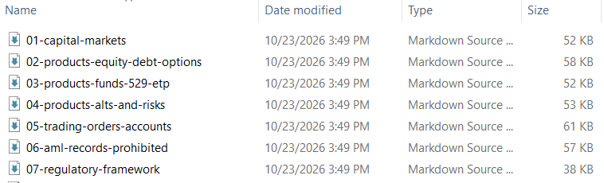
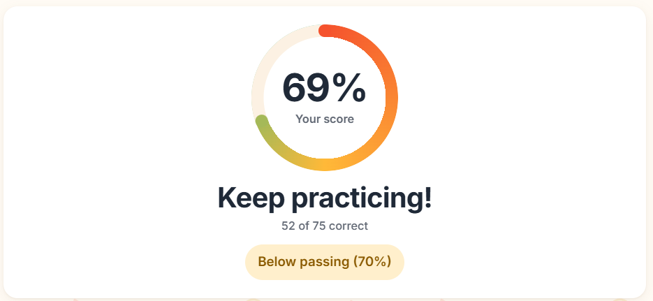
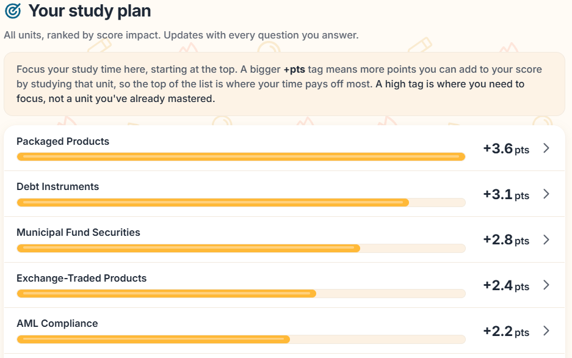

The SIE Exam is a fundamental, mandatory exam in order to work with the financials for deemed companies. It is the first gateway exam that turns finance students into people working in the corporate world. It is usually sponsored by the firm hiring them, and further qualification exams can only be taken if a firm sponsors them. The SIE is the one exception to this rule, so I decided to embark on taking this exam.

There is one slight problem: I have not studied finance, at least not nearly as much as someone getting an undergraduate degree in it. I have had some experience working in the finance sector for Jaguar Health and Golden Egg Labs, but that is not nearly enough. To add insult to injury, I gave myself two functional weeks to pass this exam, all while maintaining a steady workload. For a functional beginner, it might take 50 to 75 hours to study for this exam: I passed it with 13.

As AI has become more powerful, I decided to have it guide me on this process. To start with, [CertFuel](https://www.certfuel.com/sie/) has free SIE materials to help people study. Their content is generated with AI, so their videos are a bit hard to digest. I decided to download their transcripts, feed them through Cursor, and have it split up the key units into summarized Markdown files for notes. Markdown files are crucial to leveling up the efficiency of AI, since AI is very good at managing Markdown files. You can use Markdown files to store information to feed into future models to make them more specialized, as well as to store information so that models can crystallize that information through multiple iterations.

After getting 7 markdown files (each of them spliced into a day's worth of studying), I spent an hour going through each of them to learn that material. That gave me a great guide to the underlying material. I opened these markdown files in [Markdown Live Preview](https://markdownlivepreview.com/) and used the preview as a study guide. After taking a practice exam in 30 minutes, I failed, and realized that I needed to re-study.

I realized that I am a visual learner, and the nice thing about markdown files is that implementing visuals is seamless. I was also starting to run out of time, since I had been driving constantly up and down I-95 to see family. So, I told the AI to compile these notes, litter them with visuals, make them color-coded and highlighted, and slam a timer on [the website](/sie-study/) to make sure I wouldn't spend too long on this.

After studying for this, I took two more practice exams, both on the brink of passing. I had to call it for the night, but it was a bit frustrating getting 52 questions correct when 53 questions would be a passing score.

At this point, I had studied for 11 and a half hours. I was hoping to have more studying done by then, but life caught up to me, and I needed to figure out how to pass this exam consistently. However, there was one redeeming trait of this. I was constantly scoring a similar number of points for each unit. In a final sprint, I had AI create a targeted one-hour review to optimize for points in this area. So, the morning of the exam, I committed to finishing this review and taking a final exam.

After completing the targeted review and taking the exam, I passed my first practice exam. At that point, I had to get ready to go take the real exam.

While taking the exam, I realized one thing that I had not been accounting for. For each of my practice exams, I would only complete it in 30 minutes, and only answer from my first intuition. Even though the exam had a few questions that truly stumped me, when I used the full allotted 105 minutes, that gave me time to reason through each question to pick the most reasonable answer. After submitting the exam, I felt way more comfortable with that exam compared to all of the practice exams. I will never know what I truly scored on this exam, but it clearly was enough for me to pass!
