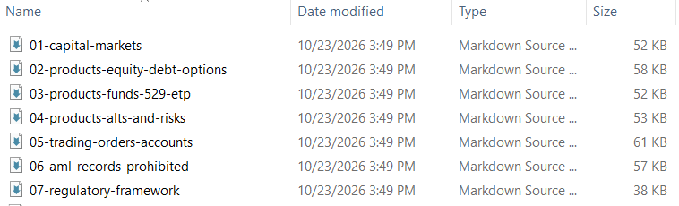
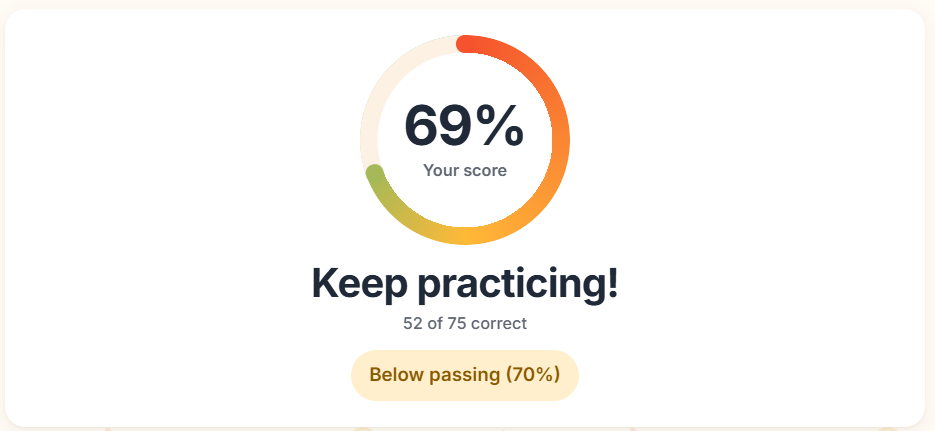
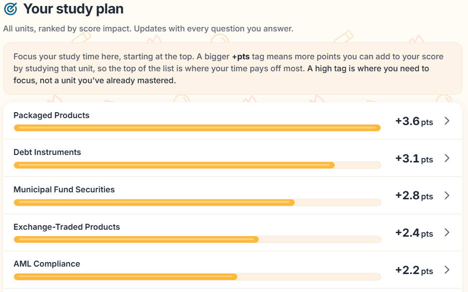

The Securities Industry Essentials (SIE) exam is FINRA's entry-level securities exam and a prerequisite for representative licenses like the Series 7. Most of those exams require a sponsoring firm; the SIE doesn't, so I decided to take it on my own.

I'm a computer science graduate, not a finance major. My finance experience came from work at Jaguar Health and Golden Egg Labs. I gave myself two weeks, alongside a full workload. Beginners typically spend 50 to 75 hours preparing; I passed on my first attempt with about 13, by treating studying as an engineering problem.

## Building the notes

[CertFuel](https://www.certfuel.com/sie/) publishes free SIE material, but its AI-generated videos are hard to digest. I downloaded the transcripts, fed them through Cursor, and had it split the key units into summarized Markdown files, one per study day. Markdown works well for this because AI handles it reliably: the same files can be refined over several passes and fed back in as context to make later prompts more specialized.

That produced seven files, from capital markets through the regulatory framework. I spent about an hour on each, reading them in [Markdown Live Preview](https://markdownlivepreview.com/) as a study guide.

## Using the first practice exam as feedback

My first practice exam came back below passing. That was useful data: reading the notes wasn't enough, and I needed a format I would actually retain. I learn visually, so I had the AI rebuild the notes into a color-coded, diagram-heavy [study site](/sie-study/) with a built-in timer to keep each session bounded.

## Targeting the last few points

My next two practice exams both landed at 52 of 75, one question short of the 70% line.

The scores were consistent across units, which meant the gap was predictable and could be targeted. About 11.5 hours in, I had the AI rank every unit by the points still available and build a one-hour review in that order, which I did the morning of the exam.

After that review I passed my first practice exam and went in for the real one.

## Test day

One lesson from test day: I had been finishing practice exams in about 30 minutes on first instinct. On the real exam I used the full 105 minutes to reason through the harder questions, and it showed. I passed on the first attempt.

The takeaway wasn't "study less." It was that a structured pipeline (AI-generated notes, a visual guide, and a review ordered by where I could gain the most points) can compress weeks of preparation into a few focused days.
